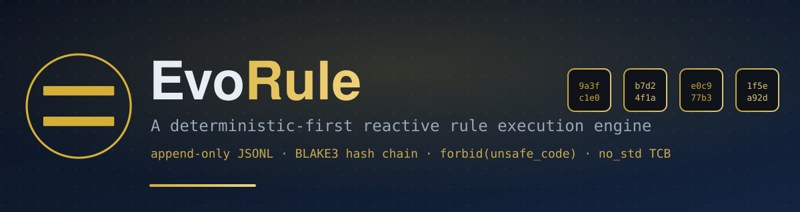

# EvoRule — Deterministic-First Rule Governance Engine

EvoRule is a deterministic-first rule governance engine: **provable, replayable, tamper-evident decisions on a BLAKE3 audit chain** — not just logged.

[![CI][badge-ci]][ci-link]
[![License: AGPL-3.0-or-later][badge-license]][license-link]

**License**: [AGPL-3.0-or-later](LICENSE) with [dual licensing](DUAL_LICENSE.md) · the constitution [`core_eval.json`](evorule-tcb/core_eval.json) is [CC0-1.0 public domain](LICENSES/core_eval-CC0-1.0.txt)

**Where EvoRule sits**

| If you have… | Existing tools give you… | EvoRule adds |
|---|---|---|
| an LLM / agent that *acts* | observability (LangSmith, AgentV): *see* what it did, after the fact | a gate that *stops* what it shouldn't do, before it runs |
| a policy decision point | policy-as-code (OPA, Cedar): *allow / deny* at a point | the same decision, written to a signed hash chain you can *prove* and *replay* |
| a compliance requirement | "keep a log" | a decision artifact that survives audit and tampering challenges |

**For:** teams that must *prove* how a decision was made — regulated finance, healthcare, MLPS 2.0 / EU AI Act / DORA, offline or air-gapped Rust backends, and agent-platform builders.
**Not for:** simple allow/deny already on AWS (→ Cedar); full BPMN workflows (→ Temporal / Camunda); "just log it" (→ OpenTelemetry).

> **The constitution is public domain.** [`core_eval.json`](evorule-tcb/core_eval.json) — the core_eval rule spec (~7KB) — is dedicated to the public domain under [CC0-1.0](LICENSES/core_eval-CC0-1.0.txt): 8 transform rules built from just 3 meta-instructions (branch / set / push) define all 7 instruction semantics. Implement a compatible engine — no permission required.

Design stance: determinism first, no silent pass-through (fail-closed), minimal trusted computing base, and honest capability boundaries — every technical claim is traceable to a code line or a test name.

---

## Repository Map

The ecosystem is twelve repositories. One-line descriptions below match each repo's README and its GitHub "About" panel.

| Repository | What it is | Type |
|---|---|---|
| [evorule-server](https://github.com/evorule/evorule-server) | official HTTP entrypoint for the engine: session API, audit SSE, auth, hot-reload, template market | application |
| [evorule-rule](https://github.com/evorule/evorule-rule) | rule asset governance layer: JSON rule library + governance service for storage, versioning, review and audit | application |
| [evo-agent](https://github.com/evorule/evo-agent) | trustworthy AI agent orchestration on the evorule engine — every execution leaves an auditable, replayable fact chain | application |
| [evorule-console-cloud](https://github.com/evorule/evorule-console-cloud) | compliance and audit console for AI agents, with an in-browser demo | application |
| [evorule-bundle](https://github.com/evorule/evorule-bundle) | snapshot sharing and verification crate: the transfer contract between governance and execution sides | library |
| [evorule-hash](https://github.com/evorule/evorule-hash) | governance normative hashing crate (BLAKE3): single source of truth for the governance trio, byte-compatible with the engine | library |
| [evorule-system-rules](https://github.com/evorule/evorule-system-rules) | the system constitution of the ecosystem: schema, version and upgrade authority for all system JSON | contract & data |
| [evorule-wasm-demo](https://github.com/evorule/evorule-wasm-demo) | the real kernel compiled to WebAssembly: deterministic rule execution fully in-browser, zero server | demo |
| [evorule-context-inspector](https://github.com/evorule/evorule-context-inspector) | LLM context snapshot and health audit chain — "what the agent saw" is verifiable, replayable, private by default | tooling |
| [evorule-integration-tests](https://github.com/evorule/evorule-integration-tests) | cross-repo contract gate tests for the ecosystem: hash-domain and version compatibility enforcement | tooling |
| [evo-agent-desktop](https://github.com/evorule/evo-agent-desktop) | desktop shell (Windows x64): release and auto-update channel for the agent workstation | desktop app |

Organization home: [github.com/evorule](https://github.com/evorule)

---

## Quick Start

### Prebuilt binaries (recommended)

Single-file executables for Linux x86_64 and Windows x86_64 — zero dependencies, run directly. Attached to each [GitHub release](https://github.com/evorule/evorule/releases/latest).

### Use as a library

Core crates are published on crates.io:

```rust
use evorule_reactor::{Reactor, Fact, FactId};
use evorule_tcb::JsonValue;

// Load the transform rule set (the "constitution") from core_eval.json
let reactor = Reactor::builder(core_eval_rules)
    .max_rounds(1000)
    .build();

// spawn returns (FactSender, EventReceiver, EventSender, ReactorHandle, FactsLog)
let (tx, mut rx, ..) = reactor.spawn();

// Submit an instruction and receive the resulting fact chain
tx.send(Fact::Command {
    id: FactId(1),
    instruction: JsonValue::object_from_pairs(&[
        ("type", JsonValue::string("increment")),
        ("params", JsonValue::object_from_pairs(&[
            ("attr", JsonValue::string("x")),
            ("delta", JsonValue::Integer(5)),
        ])),
    ]),
}).unwrap();

while let Ok(fact) = rx.recv() {
    println!("{fact:?}"); // StateTransition → Stable
}
```

### Command line

```bash
# Validate a rule set
evorule validate ./rules/

# Execute an instruction and emit the fact chain
echo '{"type":"increment","params":{"attr":"x","delta":5}}' | evorule run --rules ./rules/

# Verify the integrity of a fact chain
evorule verify-chain ./output/facts.jsonl

# Replay a fact chain
evorule replay ./output/facts.jsonl
```

### Build from source

```bash
cargo build --release                                      # default build (zero unsafe)
cargo build --release --features persistence               # WAL file backend
cargo build --release -p evorule-reactor --features ffi    # C FFI
cargo test --workspace --features persistence              # full test suite
```

Supported platforms: **Linux x86_64 / Windows x86_64** (prebuilt artifacts & CI coverage). macOS builds from source but is outside CI coverage and unverified.

---

## Security

- **Vulnerability reports**: <evorulelab@gmail.com> with `[SECURITY]` in the subject — disclosure procedure in [SECURITY.md](SECURITY.md)
- **Supply-chain posture**: [OpenSSF Scorecard](https://securityscorecards.dev/viewer/?uri=github.com/evorule/evorule) checks run continuously

## Documentation

- **Start here**: [DOCS_INDEX.md](DOCS_INDEX.md)
- **Deep dive**: the mdBook under [docs/](docs/) — architecture, determinism model, design decisions
- **Formal verification**: [verification/](verification/) — whitepaper, evidence conventions, and per-proof status in [STATUS.md](verification/STATUS.md) (the single source of truth)
- **Ecosystem**: every repository in the map above ships its own `docs/` (Diátaxis-structured in [evorule-system-rules](https://github.com/evorule/evorule-system-rules) and [evorule-console-cloud](https://github.com/evorule/evorule-console-cloud))

## Governance & Gates

Beyond CI, dedicated workflows enforce:

| Gate | Workflow | What it enforces |
|---|---|---|
| License compliance | [`license-gate.yml`](.github/workflows/license-gate.yml) | license compliance and distribution surface across the ecosystem |
| Public face | [`public-face.yml`](.github/workflows/public-face.yml) | public-face discipline scan |
| Code scoring | [`scorecard.yml`](.github/workflows/scorecard.yml) | OpenSSF Scorecard checks |
| Release | [`release.yml`](.github/workflows/release.yml) | release packaging |
| CLA | [`cla.yml`](.github/workflows/cla.yml) | contributor license agreement check |

## Contributing

- Every contribution requires a signed CLA: [CLA-individual.md](CLA-individual.md) · [CLA-corporate.md](CLA-corporate.md) (companies: manual email process)
- Change requirements: new features ship with tests; no `unsafe` (forbidden in tcb / governance / cli; feature-gated in reactor FFI only); every error path raises explicitly — no silent pass-through
- Flow: fork → feature branch → commit → pull request on GitHub

## License

- **Code**: [AGPL-3.0-or-later](LICENSE) — free for compliant use; closed-source embedding/distribution requires the [free commercial license](FREE_COMMERCIAL_LICENSE.md) (free for eligible entities) or a [commercial license](COMMERCIAL_LICENSE.md). History and terms: [DUAL_LICENSE.md](DUAL_LICENSE.md). Note: the license of already-published crates.io versions cannot be changed retroactively.
- **The constitution** [`core_eval.json`](evorule-tcb/core_eval.json): [CC0-1.0](LICENSES/core_eval-CC0-1.0.txt) (public domain)
- **Contributions**: CLA required (see Contributing)

---

*Every technical claim in this README is traceable to a code line or a test name. Current test and verification status lives in the repository ([verification/STATUS.md](verification/STATUS.md), CI). If any statement disagrees with the code, please open an issue.*

[badge-ci]: https://github.com/evorule/evorule/actions/workflows/ci.yml/badge.svg
[ci-link]: https://github.com/evorule/evorule/actions/workflows/ci.yml
[badge-license]: https://img.shields.io/badge/license-AGPL--3.0--or--later-blue?style=flat-square
[license-link]: LICENSE
