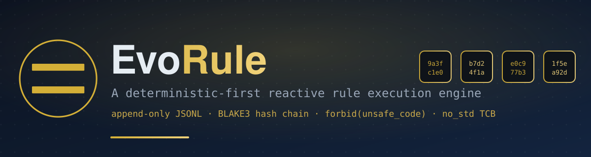

<!--
  Copyright 2026 EvoRule Project

  This program is free software: you can redistribute it and/or modify
  it under the terms of the GNU Affero General Public License as published by
  the Free Software Foundation, either version 3 of the License, or
  (at your option) any later version.

  This program is distributed in the hope that it will be useful,
  but WITHOUT ANY WARRANTY; without even the implied warranty of
  MERCHANTABILITY or FITNESS FOR A PARTICULAR PURPOSE.  See the
  GNU Affero General Public License for more details.

  You should have received a copy of the GNU Affero General Public License
  along with this program.  If not, see <https://www.gnu.org/licenses/>.

  SPDX-License-Identifier: AGPL-3.0-or-later
-->

# EvoRule Trademark Policy

  
    

**Version**: 1.0
**Effective date**: 2026-07-19

---

## Overview

The **"EvoRule"** name, logo, and brand assets are **trademarks** of the EvoRule Project.

While the EvoRule code is open-sourced under the **AGPL-3.0-or-later license**, the **trademarks are reserved** to ensure quality consistency and to prevent confusion about who stands behind the project.

This policy explains **which uses are permitted** and **which require prior permission**.

---

## Trademark List

The EvoRule Project owns the following trademarks (collectively, the "EvoRule Trademarks"):

| Trademark | Type |
|---|---|
| **EvoRule** | Word mark |
| **EvoRule Logo** (standalone logo, to be produced) | Figurative mark |
| **EvoRule Banner** (evorule-banner.svg, existing) | Figurative mark |
| **"Rules do not speak. They only run. And we are among the first to witness them."** (translation of the registered-candidate slogan) | Slogan (possible registration) |
| **"Knowledge Execution"** | English slogan (possible registration) |
| **"Accepts and runs JSON datasets only"** (translation of the registered-candidate slogan) | Chinese slogan (possible registration) |

---

## ✅ Permitted Uses (no prior permission required)

### 1. Descriptive Use

You may **freely** use the "EvoRule" name to **describe** EvoRule-related activities, for example:

- "This site is powered by the EvoRule reactive execution engine"
- "This article explains how to solve problem X with EvoRule"
- "EvoRule community (locale name) group"
- "EvoRule project community conference"

### 2. Compatibility Statements

You may use the EvoRule logo to declare compatibility, **in a non-misleading way**, for example:

- "Built with EvoRule" (with the EvoRule logo)
- "Based on EvoRule" (with the EvoRule logo)
- "EvoRule-compatible" (with the EvoRule logo)

**Prerequisites**:

- ✅ The logo must not be modified
- ✅ It must be made clear that this means "compatible", not "official"
- ✅ It must not imply official certification or endorsement

### 3. Open Source Contribution

You may use the EvoRule trademarks for contributions **to the EvoRule project itself** (commit messages, PR descriptions, etc.) without permission.

### 4. Academic / Educational Use

You may use the EvoRule name and logo (in a non-misleading way) in:

- Academic papers (citing EvoRule)
- Teaching materials (introducing EvoRule)
- Technical blogs (discussing EvoRule)

### 5. Press / Journalism

The media may use the EvoRule trademarks normally in news reporting, technical reviews, and interviews.

---

## ❌ Prohibited Uses (without prior written permission)

### 1. Implied Official Endorsement

- ❌ Any way of implying that the EvoRule Project "endorses", "certifies", or "recommends" you or your product
- ❌ Using the EvoRule trademarks to **promote** products or services unrelated to EvoRule
- ❌ Using phrases such as "Powered by EvoRule" without a genuine EvoRule integration

### 2. Domains and Social Media

- ❌ Registering domains containing "evorule" (with or without variants, hyphens, subdomains)
  - Permitted exception: `evorule.your-company.com` for a compatibility product
- ❌ Registering "@evorule" or social media accounts starting with "evorule" (unless officially authorized)
- ❌ Creating accounts that look official, such as "evo-rule", "evorule_xxx", "xxx_evorule"

### 3. Modifying or Deriving Trademarks

- ❌ Changing the logo's colors, proportions, or fonts
- ❌ Combining the logo with other trademarks (which may cause confusion)
- ❌ Using the logo as part of a product name or company name
- ❌ Registering the logo as a trademark (in your jurisdiction)

### 4. Commercial Use

- ❌ Using the EvoRule trademarks for marketing in **commercial products or services** without prior commercial permission
- ❌ Using the EvoRule trademarks to imply that your product is the "official EvoRule edition" or the "EvoRule-recommended edition"

### 5. Disparagement or Misleading Use

- ❌ Any use that could damage the reputation of the EvoRule trademarks
- ❌ Any use that could mislead consumers into believing your product/service is an official EvoRule offering

---

## 📋 Uses Requiring Prior Written Permission

| Use | Permission requirement |
|---|---|
| Using "EvoRule" in a product name / company name | Required |
| Creating EvoRule-themed merchandise (T-shirts, stickers, etc.) | Required |
| Using the EvoRule trademarks in large-scale marketing campaigns | Required |
| Registering domains containing "evorule" | Required |
| Using terms such as "EvoRule certified" in training / consulting businesses | Required |

**Contact**: <evorulelab@gmail.com> (add `[Trademark]` to the subject)

---

## Brand Guidelines

If you need to use the EvoRule logo, please follow these rules:

1. **Minimum size**: the logo must be no smaller than 32×32 pixels on digital media and no smaller than 10mm in print
2. **Clear space**: keep clear space of at least 1/4 of the logo's height around the logo
3. **Background**: use a dark logo on light backgrounds and a light logo on dark backgrounds. **Do not** use complex backgrounds
4. **No modification**: do not rotate, stretch, recolor, or add shadows or effects to the logo
5. **Complete use**: always use the complete logo + "EvoRule" wordmark combination

---

## Handling Violations

If a use that violates this policy is discovered, the EvoRule Project will:

1. **First instance**: reach out amicably and request that the use stop
2. **Second instance**: issue a formal written warning
3. **Continued**: take legal action (trademark infringement)

---

## Third-Party Project Naming

If you develop a third-party project compatible with EvoRule, you **may** use the following naming conventions:

- ✅ `EvoRule Connector for XXX`
- ✅ `EvoRule Plugin: XXX`
- ✅ `EvoRule-compatible XXX`
- ❌ `EvoRule XXX` (implies official status)
- ❌ `XXX for EvoRule` (implies an official plugin)

**Prerequisite**: state **clearly** in the README/documentation that "this project is a community contribution and not an official product of the EvoRule Project".

---

## EvoRule-Compatible Implementations (based on the CC0 constitution)

Because `core_eval.json` is dedicated to the public domain under **CC0 1.0**, you may implement your own EvoRule-compatible engine based on it. **However**:

- ✅ You may call it an "EvoRule-compatible Engine"
- ✅ You may reference the EvoRule constitution
- ❌ You **must not** call your implementation "EvoRule" (the brand is exclusive)
- ❌ You **must not** use the EvoRule logo as the identity of your implementation

This embodies the **"standard vs implementation"** separation: the constitution is public, the brand is private.

---

## Contact

- **Trademark use permission requests**: <evorulelab@gmail.com> (add `[Trademark]` to the subject)
- **Infringement reports**: <evorulelab@gmail.com> (add `[Trademark Violation]` to the subject)
- **Official website**: <https://github.com/evorule/evorule>

---

## Version History

| Version | Date | Change |
|---|---|---|
| 1.0 | 2026-07-19 | Initial version

---

